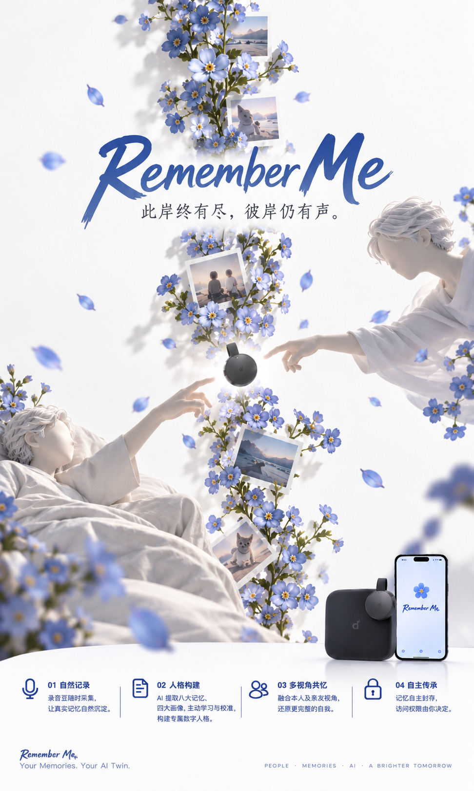
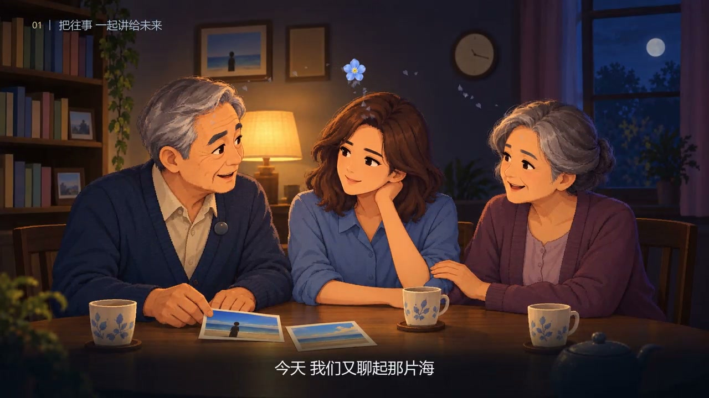
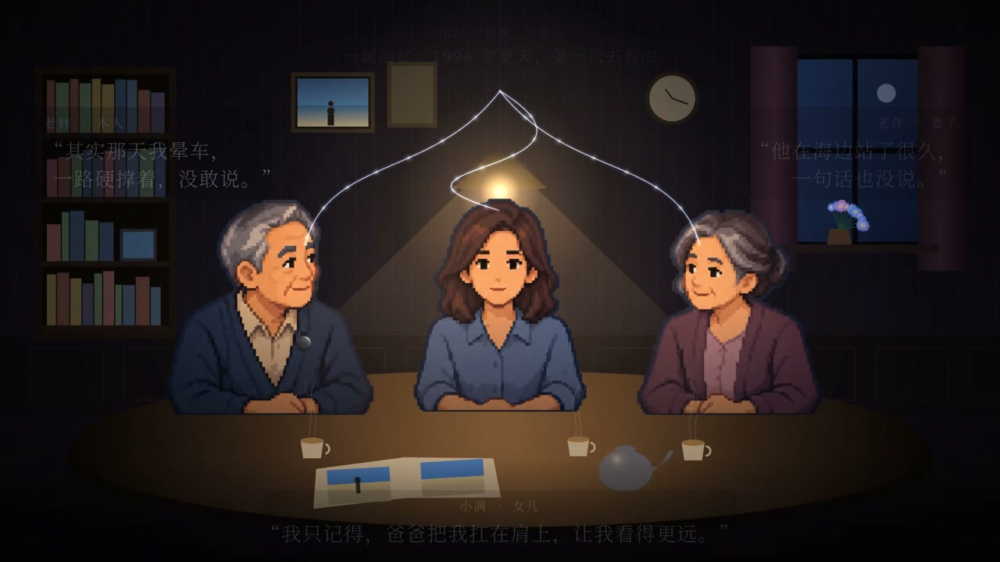
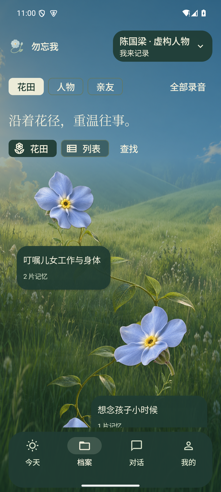
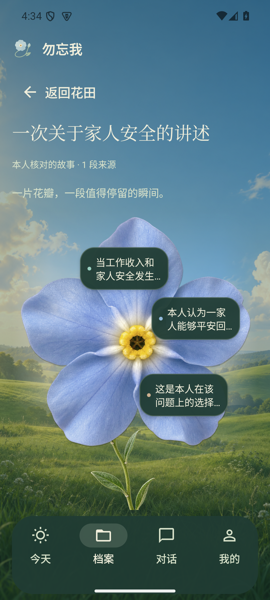
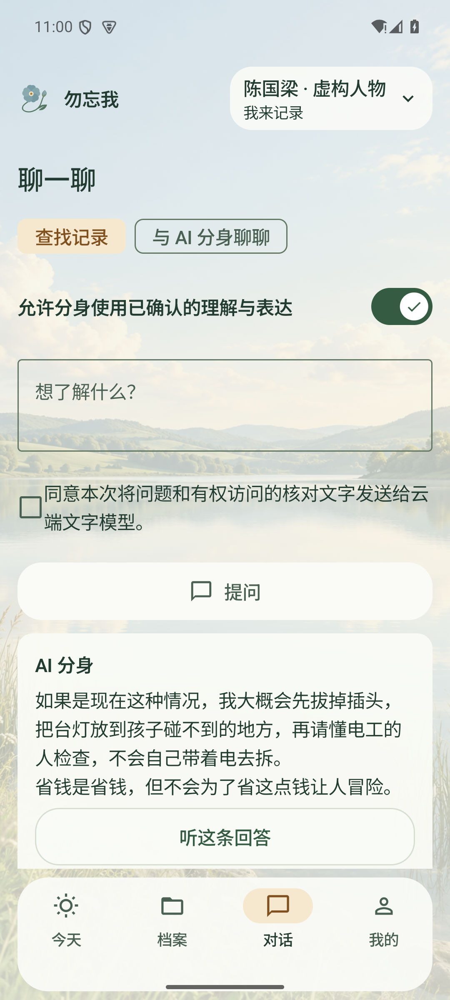

# 勿忘我 · Remember Me

**记录原话，留下故事，慢慢理解一个人。**

A living memory garden, grounded in your own words.

[最新演示](#最新演示)

**Remember Me** 是一个围绕人生讲述、个人记忆和人物理解构建的 AI 产品原型。使用者自然地说一段话，系统保留原音、生成可核对的文字，再将故事、关系、偏好和表达方式整理为有来源的记忆。随着本人不断确认与修正，这些材料形成可追溯的人物理解，并支持带依据的问答与对话。

项目用「勿忘我」作为视觉意象：一段故事长成一朵花，一片花瓣展开一段记忆，花径连接一个人的不同经历。原始讲述、系统整理、本人确认的理解与 AI 模拟分别标注，读者可以回到原文与原音。

## 最新演示

  
  
<strong>此岸终有尽，彼岸仍有声。</strong> Your Memories. Your AI Twin.

<table>
  <tr>
    <td align="center" width="50%">
       
      <b>宣传短片 · 1:00</b> 
      <a href="docs/media/remember-me-promo-01.mp4">▶ 观看视频</a>
    </td>
    <td align="center" width="50%">
       
      <b>宣传长片 · 2:23</b> 
      <a href="docs/media/remember-me-promo-02.mp4">▶ 观看视频</a>
    </td>
  </tr>
</table>

点击封面或「观看视频」进入视频文件页；[查看原尺寸海报](docs/media/remember-me-poster.png)。

## 看一眼产品

<table>
  <tr>
    <td align="center" width="33%"> <b>记忆花田</b> 沿着花径浏览人生故事。</td>
    <td align="center" width="33%"> <b>故事与花瓣</b> 展开内容，回到讲述来源。</td>
    <td align="center" width="33%"> <b>有依据的对话</b> 区分原话、理解与模拟。</td>
  </tr>
</table>

以上为 2026-10-11／12 的 Android 原生验收截图，使用虚构演示人物。它们展示记忆花田与对话的设计；Android 0.16.8 已简化对话入口。

## 一段讲述怎样成为记忆

**录音或导入 → 转写与本人核对 → 故事与记忆提取 → 人物理解候选 → 本人确认 → 有据对话 → 修正与继续记录**

1. **先留下原话。** 手机录音、音频导入和部分录音设备适配提供采集入口；原始素材与处理状态分开保存。
2. **核对之后再理解。** 转写可以修订；提取出的记忆保留来源、时间、类型和版本。人物理解先进入候选，再由本人确认。
3. **带着依据交流。** 能用原文回答时优先引用；需要结合已确认理解作出模拟时，明确显示类型与依据。材料不足保留失败和未知状态。
4. **允许改变和撤回。** 修正、删除与撤销授权会影响依赖这些来源的记忆、理解和回答，避免继续展示失效的结论。

## 核心能力

| 能力 | 产品中的体验 |
| --- | --- |
| **自然采集** | 原生录音、转写核对、处理进度与原音回听；重处理任务留在后台。 |
| **记忆花园** | 以故事、花瓣、列表及人物视角浏览内容，并追溯支持和例外依据。 |
| **人物理解** | 关注身份、经历、关系、偏好、价值、选择与表达；保留候选、确认、冲突和版本。 |
| **证据问答与 AI 分身** | 使用获准的原文和已确认理解，区分引用与模拟；支持原生平台的文字／语音路径。 |
| **比较与校正** | 锁定系统回答，再对照本人的回答，整理差异并继续补充材料。 |
| **亲友补记与托付** | 支持授权范围内的补充、专属信与接收入口；第三方记录保留作者与来源身份。 |
| **独立的声音授权** | 录音许可、云端对话、声音与亲友访问分别管理，供应商适配留在服务端。 |

这是持续开发的展示原型。各能力的平台覆盖和验收程度不同；真实通话延迟、录音设备、长时后台与真机表现以对应交付记录为准。

## 展示范围

本仓库仅包含作品介绍、精选截图、宣传海报与演示视频。项目源码、开发文档和服务端配置不公开。
